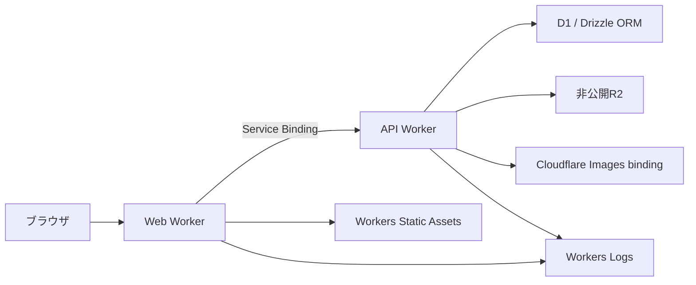

# アーキテクチャ方針

更新日: 2026-10-26。現在の構成と、今後採用する構成を分けて記録します。将来構成の技術選定は以下の方針とし、互換性や実装方法は後続工程で検証します。

## 目的とコンテンツ管理

エンジニア採用に向けて、菊田佑輔の開発実績、担当範囲、設計上の判断を伝えます。Solana・DeFiの経験を中心に紹介します。プロフィールと実績はコードで管理し、ブログ記事は将来自作する管理画面とDBで管理します。

今回更新するのは開発文書のみです。ソース・実行設定・依存関係や、サイトに表示するプロフィール・文言・実績データ・画面・画像・動画・アニメーションは変更しません。

## 現在動作している構成

- `apps/web` に既存のNext.js App Router / OpenNextアプリを配置しています。ホーム `/`、実績 `/works`、問い合わせAPI `/api/contact` を維持します。
- Node.js 24.19.0、pnpm 11.22.0と既存依存バージョンを維持します。ルートのpnpm workspaceからWeb用コマンドを `@portfolio-v4/web` へ明示的に委譲します。
- パッケージ管理とworkspace管理は、2026-10-26にpnpmの継続採用を正式決定しました。既存のworkspace・CI・依存関係保護設定が整っており、今回のアプリケーションにBun固有の機能を必要としていないためです。Bun移行を必須タスクから外し、具体的な必要性が生じた場合のみ任意に再評価します。[現在の決定と2026-10-24の調査履歴](package-manager-migration.md) を参照してください。
- ルートの単一 `pnpm-lock.yaml`、E2E、Playwright設定、CI、ESLint・TypeScriptによるルートE2E検査を維持します。アプリ専用の設定・環境変数サンプルは `apps/web` に置きます。
- OpenNextは `apps/web/.open-next` にWorkerと静的assetsを生成し、`apps/web/wrangler.jsonc` が参照します。Cloudflare Workersは現行アプリでも利用します。
- ブログ、管理画面、独立したAPI Worker、以下の認証・DB・画像基盤は未実装です。`apps/api` と `packages/contracts` は存在せず、今回空ディレクトリや仮実装を追加しません。

実行コマンドと外部ビルド設定の確認事項は [README](../README.md)、過去の移動前後の検証結果は [workspace整理の記録](workspace-migration.md) を参照してください。今回の文書更新ではアプリの全テスト・ビルドを再実行しません。

## 将来の採用方針

パッケージ・workspace管理は現行のpnpmを継続します。以下の将来のWeb/API・認証・DB基盤は未実装であり、導入済み・検証済みとは扱いません。

| 項目 | 採用方針・用途 |
| --- | --- |
| 言語 | TypeScript |
| フロントエンド | React + TanStack Routerによる公開画面・管理画面 |
| バックエンド | Hono |
| アプリケーションAPI | oRPC |
| 認証 | Better Auth + Passkeyプラグイン |
| DB | Cloudflare D1（SQLite） |
| ORM | Drizzle ORM |
| アップロード画像の保存 | 非公開のCloudflare R2 |
| アップロード画像の変換 | Cloudflare ImagesのWorkersバインディング |
| 実行基盤 | Web WorkerとAPI Workerを分離 |
| WebからAPIへの接続 | Service Binding |
| データへのアクセス | DB・R2・ImagesへのアクセスをAPI Workerに集約 |
| 静的ファイル配信 | Workers Static Assets |
| ログ | Workers Logs |
| パッケージ・workspace管理 | pnpmを継続採用（現在も導入済み） |
| その他の開発ツール候補 | Turborepo、Lefthook、Oxlint、Oxfmt（いずれも未導入） |
| 初期構成の参考 | Better T Stack |

React Router Framework Mode、PostgreSQL、Hyperdriveは旧案です。今後の採用方針としては使用しません。TanStack RouterをTanStack Startに読み替えません。**公開ページのSSRは将来実装する要件**であり、TanStack RouterとWorkersでの実装方法を後続で検証します。現行Next.jsの描画方式を、この要件の実装完了とは扱いません。

## 将来の責務と接続

この図は未実装の予定構成です。

| 境界 | 責務 |
| --- | --- |
| Web Worker | React + TanStack Routerの公開画面・管理画面と、将来の公開ページSSRを担当。API WorkerへService Bindingで接続し、D1・R2・Imagesには直接アクセスしない |
| API Worker | Hono上のAPI、oRPCによるアプリケーションAPI、Better Auth + Passkeyの認証、DB・画像処理を担当。管理操作と公開データ取得の境界を検証・仕様化する |
| D1 / Drizzle ORM | ブログ記事などのDB保存とアクセスを担当。スキーマ・マイグレーション・運用手順はバックエンド工程で検証する |
| 非公開R2 / Images binding | R2にアップロード画像を保存し、API WorkerからImages bindingで変換する。R2バケット自体は公開せず、配信方法・公開範囲・管理操作の認可を後続で定める |
| Workers Static Assets | アプリの静的ファイル配信を担当。アップロード画像を保存する非公開R2とは用途を分ける |
| Workers Logs | Web/API Workerの運用ログを扱う。秘密情報や問い合わせの個人情報を出力しない制約を維持する |

プロフィール・実績のコード管理と、ブログ記事の管理画面・DB管理を分けます。現行の問い合わせ処理は [問い合わせセキュリティ設計](contact-security.md) に従い、問い合わせ本文や個人情報をDB・R2・アプリログなどへ保存しない制約を維持します。将来のD1・R2導入は、問い合わせデータの保存を許可するものではありません。

## 後続工程で検証・決定する事項

以下は未解決の検証項目です。対応済みと扱ったり、未指定の数値・実装方法を今回決定したりしません。

- Hono・oRPC・Drizzle ORM・D1がAPI Worker上で連携すること、型と入力検証の境界、マイグレーションの実行・復旧手順。
- Better AuthとPasskeyプラグインのD1連携、登録・ログイン・管理操作の認可、認証情報の管理、失効・復旧手順。認証期限や運用条件は検証後に定める。
- Web/API Worker間のService Binding接続、セッション情報の受け渡し、認証時のorigin・cookie・パスキーのドメイン条件。
- 非公開R2とImages bindingをAPI Workerだけで扱うこと、アップロード・画像変換・公開配信・管理操作の境界。入力上限や画像条件は仕様として別途決定する。
- D1・画像データのバックアップと復旧、保持期間、Workers Logsの出力内容。問い合わせの個人情報やsecretをログへ含めないこと。
- React + TanStack Routerによる公開ページSSRの構成とWorkers互換性、Workers Static Assetsとの配信分担。TanStack Startの採用を前提に解決しない。

これらは次のバックエンド基盤・認証検証および後続工程への準備事項です。今回の文書更新を、将来構成の実装・互換性確認の完了として扱いません。

## 移行順と今回の境界

1. **リポジトリ整理（実施済み・未コミット差分あり）**: 既存Next.js / OpenNextを `apps/web` に配置し、pnpm workspace、設定、文書を整理済み。既存差分を保持する。
2. **バックエンド基盤と認証の検証**: Hono・oRPC・D1・Drizzle・Better Auth + Passkey、Worker分離と接続を検証し、未決定の条件を整理する。
3. **ブログAPI**: 検証済みの基盤に記事管理と必要な画像処理を実装する。
4. **フロントエンド実装**: 画像生成で複数案を比較し、画面・トークン・モーションの仕様をまとめた後、React + TanStack Routerの公開画面・管理画面と公開ページSSRを実装する。

バックエンド基盤と認証の検証は、pnpmと既存ツールのまま始められます。Bun移行や開発ツールの入れ替えは開始の前提条件にしません。Turborepo・Lefthook・Oxlint・Oxfmtは未導入の候補で、今回導入しません。将来ツール変更を検討する場合も、必要性を確認したうえで既存の依存保護・lint・型検査・unit・Worker build・E2Eを維持します。Better T Stackは構成の参考に限り、既存リポジトリに生成処理を実行しません。

今回、画像生成・UI変更・機能追加・外部Cloudflare設定変更・デプロイ・ブランチ操作・コミット・push・PR作成は行いません。現在のnoindex、問い合わせ処理の保護、実績を捏造しない方針を維持し、未コミットのレビュー可能な差分を残して終了します。バックエンドやフロントエンドの実装は自動的に開始しません。

旧要件書・Product Cinema資料は過去の目的・判断の履歴として残します。新しい採用方針はこの文書、現在の配置とコマンドは [README](../README.md)、作業上の安全制約は [AGENTS.md](../AGENTS.md) を参照してください。
